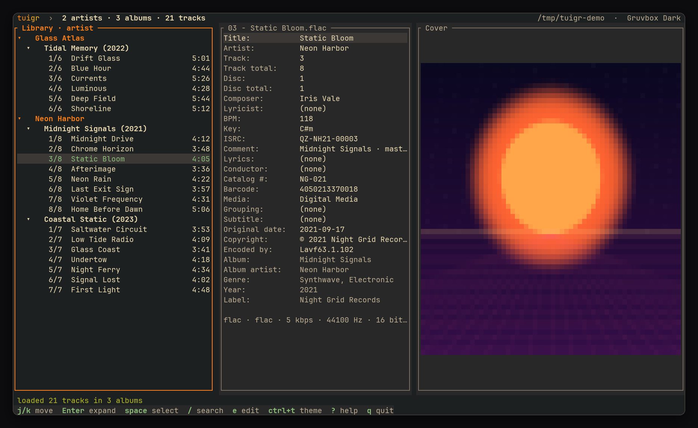
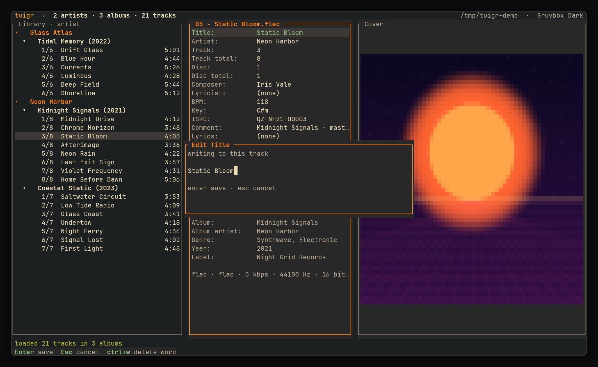
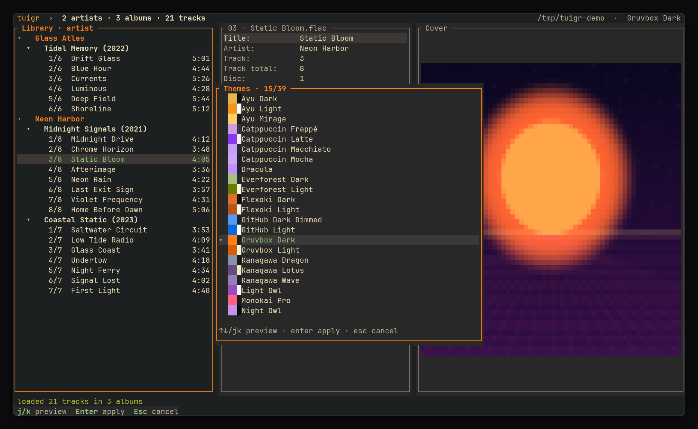

# tuigr

`tuigr` browses and edits music file tags from the terminal. It is written in
Rust with [`ratatui`](https://ratatui.rs), uses
[`lofty`](https://github.com/Serial-ATA/lofty-rs) for audio metadata, and
[`opaline`](https://github.com/hyperb1iss/opaline) for themes.

It has two faces:

- a **TUI** with an artist → album → track tree, album and track editors,
  bulk editing, search, cover art, playback, MusicBrainz lookup and the full
  opaline theme collection, and
- a **CLI** for reading fields and applying batch edits.

Reads parse only tag headers and stream properties. Writes are
read-modify-write: only fields that changed are touched, and format-specific
items we do not model remain on the file.

## Features

- **Fast library browser** — artist → album → track tree with collapsible
  levels, multiple sort modes, multi-selection, and parallel scanning.
- **Complete tag editing** — title, artist(s), album, album artist, genre(s),
  year/date, track and disc numbers, compilation, comment, lyrics, composer,
  conductor, lyricist, BPM, key, ISRC, label, catalog number, barcode, media,
  grouping, subtitle, original date, copyright, encoded-by and MusicBrainz
  IDs.
- **Album and bulk editing** — edit every track in an album at once, or
  multi-select tracks across albums and edit their shared fields.
- **Powerful search** — free text plus field queries, comparisons, negation,
  `OR` groups, format/lossless/cover filters, and required-tag auditing.
- **Cover art** — asynchronous cover panel, embedded and folder artwork,
  Cover Art Archive downloads, and set/remove/extract actions.
- **MusicBrainz lookup** — search releases, fetch tracklists, apply album
  metadata and artwork, and match local files by title or track order.
- **Themes** — every opaline built-in theme, with a live-preview picker on
  `ctrl+t`; the default is Ayu Dark.
- **File organization** — configurable rename patterns, move-to-library,
  slugification, track-number guessing and renumbering.
- **Playback and links** — play a track or album with your configured player,
  open the containing folder, or launch a configurable web search.
- **Required-tag checks** — jump to the next incomplete track in the TUI, or
  run `tuigr check` from the CLI.
- **Full CLI** — `list`, `get`, `set`, `modify`, `rename`, `guess`, `cover`,
  `stats`, `check`, `lookup`, `themes`, shell completions and a man page, with
  JSON output where useful.
- **Configuration** — library path, player, sort order, theme, tag grouping,
  search URL, rename format, required tags, cover behavior and scan workers.
- **Broad format support** — MP3, FLAC, M4A/MP4, Ogg Vorbis, Opus, WAV, AIFF,
  APE, WavPack and the other formats understood by `lofty`.

## Screenshots

All screenshots use the **Gruvbox Dark** theme and a small demo library.



*The library tree with expanded albums, the track editor pane and the cover panel.*



*Editing a tag in place; the same editor works for album-wide and multi-track edits.*



*The theme picker previews every opaline theme immediately across the whole interface.*

## Supported formats

MP3, FLAC, M4A/MP4, Ogg Vorbis, Opus, WAV, AIFF, APE, WavPack and the other
formats supported by `lofty`.

## Build

```sh
cargo build --release
./target/release/tuigr --help
# or
cargo install --path .
```

## Configuration

Configuration lives at `$XDG_CONFIG_HOME/tuigr/config.toml`, or
`~/.config/tuigr/config.toml` when `XDG_CONFIG_HOME` is unset.

```toml
library = "~/Music"
player = "mpv --no-video"
sort = "artist,album,track"

# Any of the themes built into opaline.
theme = "ayu-dark"

required_tags = ["artist", "album", "title", "track"]
group_by = "tags"          # or "folder"
search_url = "https://musicbrainz.org/search?query=%a+%L&type=release"
rename_format = "%A/%L/%n - %t"
slugify = false

cover_art = "embed"        # or "folder", "both"
cover_file = "albumart.jpg"
cover_panel = false

id3_version = "preserve"
scan_workers = 8
musicbrainz_user_agent = "tuigr/0.2 (you@example.com)"
```

The default theme is **Ayu Dark**. `tuigr` supports exactly the themes
built into opaline — nothing else is bundled:

```sh
tuigr themes
tuigr themes --json
```

Press `ctrl+t` in the TUI to open the theme picker. Moving through the list
previews each theme immediately across the whole interface; `enter` applies
the selection and `esc` restores the previous theme. `ayu`, `gruvbox` and
`catppuccin` are accepted in the config as shortcuts for their default
variants.

`required_tags` controls the `!` missing-tag jump and the `missing:` search
filter. The default is artist, album, title and track number. `cover` is a
valid pseudo-tag.

## TUI

```sh
tuigr                  # configured library (or current directory)
tuigr ~/Music          # a library
tuigr song.flac        # one track
```

The library pane is a tree:

- artists start collapsed,
- expanding an artist reveals its albums,
- expanding an album reveals its tracks.

The right pane shows an artist summary, album editor, track editor or bulk
editor depending on the cursor and selection.

### Keys

| Key | Action |
| --- | --- |
| `↑`/`↓` / `j`/`k` | move |
| `home` / `end`, `g` / `G` | top / bottom |
| `ctrl+d` / `ctrl+u`, `pgdn` / `pgup` | page |
| `J` / `K` | next / previous artist |
| `→` / `enter` | expand artist or album, or focus detail |
| `l` | open the selected track in the detail pane |
| `h` | return from detail to the library |
| `←` | collapse artist or album |
| `E` / `C` | expand all / collapse all |
| `space` | select track, album or artist |
| `ctrl+a` | select all visible tracks |
| `tab` / `shift+tab` | switch pane |
| `e` / `enter` | edit the field under the cursor |
| `d` | clear the field |
| `x` | toggle compilation |
| `T` | guess track/disc numbers from file names |
| `!` | jump to the next track missing required tags |
| `/` | search |
| `S` | cycle album sort |
| `ctrl+t` | choose a color theme (live preview) |
| `v` | toggle the cover panel |
| `c` | cover menu: download, set, remove, extract |
| `p` / `P` | play track / album |
| `ctrl+o` | open the containing folder |
| `ctrl+k` | open the configured web search |
| `m` | MusicBrainz lookup |
| `N` / `M` | rename / move to library |
| `D` | delete files, with confirmation |
| `R` / `ctrl+r` | rescan |
| `?` | help |
| `ctrl+w` | delete the previous word in a text input |
| `esc` | cancel / close / clear selection or filter |
| `q` / `ctrl+c` | quit |

Editing an album row writes every track in the album. Editing a track row
writes one file. Every row in the track editor edits that file alone, so one
track can have its own album, album artist, genre, year, label and other
values. All editors use the same row order, most used fields first: title,
artist, album, album artist, genre, year, track and disc numbers, compilation,
then the remaining fields with lyrics last. Multi-selecting tracks enables the
bulk editor for shared fields such as album, album artist, genre, year,
artist, composer, conductor, lyricist, track total, disc, compilation, label,
catalog number, barcode, media, grouping, subtitle, original date, copyright
and encoded-by.

The optional cover panel (`cover_panel = true` or `v`) takes 40% of the width
on terminals at least 110 columns wide and renders artwork with terminal color
blocks. Embedded art is used first, then `cover_file` / conventional folder
art names.

### Search

Terms are combined with AND. `OR` starts an alternative group. `-` negates a
term. Field prefixes accept the same names and aliases as the CLI.

```text
dune
artist:herbert
album:"midnight marauders"
year:>=1990
-track:1
genre:jazz OR genre:fusion
format:flac
lossless:yes
cover:yes
has:lyrics
duration:>4m
missing:
missing:no
missing:cover
```

`missing:` finds tracks missing any configured required tag.

## CLI

```sh
tuigr list -r ~/Music
tuigr list -r --json ~/Music
tuigr list -r --flat ~/Music
tuigr list -r --albums ~/Music

tuigr get title song.flac
tuigr get artist *.flac

tuigr set -a 'A Tribe Called Quest' -b 'Midnight Marauders' \
          -A 'A Tribe Called Quest' -g 'Hip Hop' -y 1993 *.flac
tuigr set --track 3/14 --disc 1/2 song.flac
tuigr set --compilation yes *.flac
tuigr set --cover cover.jpg album/*.flac
tuigr set --remove-cover album/*.flac
tuigr set --renumber -r ~/Music
tuigr set -n --album 'New Album' album/*.flac

tuigr modify --genre -e '^hip hop$' --replacement 'Hip-Hop' -r ~/Music
tuigr guess -n -r ~/Music
tuigr rename -n -r -f '%A/%L/%n - %t' ~/Music
tuigr cover ~/Music/Album
tuigr stats -r --json ~/Music
tuigr check -r --json ~/Music
tuigr lookup --artist 'A Tribe Called Quest' --album 'Midnight Marauders'
tuigr completion bash
tuigr man
```

Every command accepts `-C DIR`. `-r` recurses. `tuigr get` prints
`path<TAB>value` when given multiple files.

### Fields

`title`, `artist`/`artists`, `album`, `albumartist`/`album-artist`,
`genre`/`genres`, `year`/`date`, `track`, `track-total`, `disc`,
`disc-total`, `compilation`, `comment`, `lyrics`, `composer`, `conductor`,
`lyricist`, `bpm`, `key`/`initialkey`, `isrc`, `publisher`/`label`,
`catalog-number`, `barcode`, `media`, `grouping`, `subtitle`,
`original-date`, `copyright`, `encoded-by`, and MusicBrainz IDs.

### Rename placeholders

| Placeholder | Field | Placeholder | Field |
| --- | --- | --- | --- |
| `%t` | title | `%a` | artist |
| `%A` | album artist | `%L` | album |
| `%n` | track number | `%N` | track total |
| `%d` | disc number | `%D` | disc total |
| `%y` | year | `%g` | genre |
| `%f` | format | `%m` | composer |
| `%l` | label | `%i` | ISRC |
| `%c` | comment | `%%` | literal percent |

Long names (`%album`, `%albumartist`, `%track`) also work. `--move` puts files
under `library`; `--root` sets the root for path patterns. Existing files are
never overwritten. `--slugify` transliterates values.

### Cover art

`tuigr cover` searches MusicBrainz by album artist/title and writes the front
cover into each album directory using `cover_file` (default `albumart.jpg`):

```sh
tuigr cover ~/Music/Album
tuigr cover -r ~/Music
tuigr cover --file folder.jpg ~/Music/Album
tuigr cover --release <MBID>
```

The TUI `c` menu also downloads, sets, removes and extracts covers.

### MusicBrainz

`lookup` searches releases and prints candidates or a release tracklist.
`--json` emits the raw MusicBrainz response. The TUI `m` dialog applies album
fields, cover art, track titles and track/disc numbers; local tracks are
matched by normalized title first, then by order.

MusicBrainz requests are rate-limited to one per second and use
`musicbrainz_user_agent`.

## Design

- `src/tags.rs` — lofty-backed read/write engine, field aliases, covers,
  audio properties and folder artwork.
- `src/library.rs` — discovery, parallel loading, album/artist grouping,
  required-tag checks and track-number guessing.
- `src/cover.rs` — Cover Art Archive downloads and release tracklist mapping.
- `src/organize.rs` — rename/move patterns and slugification.
- `src/online.rs` — MusicBrainz client.
- `src/theme.rs` — opaline theme loading and ratatui styles.
- `src/tui/` — ratatui app, hierarchy, editors, search, cover panel and dialogs.
- `src/cli.rs` — clap commands.

## Development

```sh
cargo build
cargo test
cargo clippy --all-targets -- -D warnings
cargo fmt --check
```

The development profile compiles dependencies with optimizations and turns off
debug assertions inside them, so `cargo run` decodes large embedded artwork at
roughly release speed instead of taking seconds per image.

The `testdata/` files are 0.3-second silent fixtures for MP3, FLAC, M4A, Ogg
Vorbis and Opus.
